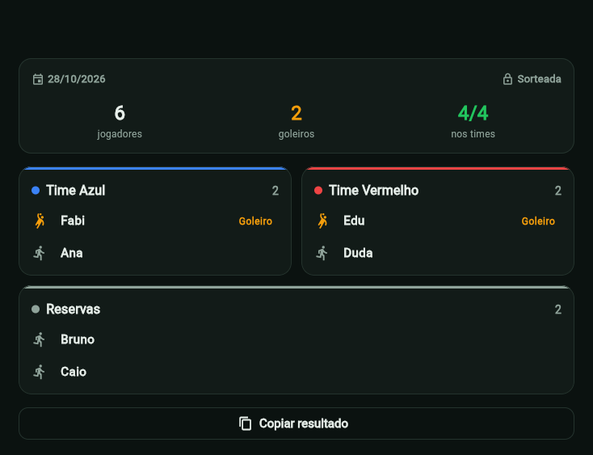

# Panelinha em Flutter (pelada-gestao-front-web)

Versão em Flutter do Panelinha: monta a lista da pelada, cadastra os jogadores e sorteia os times.
Roda na web e está preparada para Android, iOS e desktop.

[](https://github.com/WallaksCardoso/pelada-gestao-front-web/actions/workflows/ci.yml)


[](LICENSE)



## Sobre

Interface do sistema da pelada em microsserviços: o login e o cadastro de usuários usam o
[spring-jwt-auth](https://github.com/WallaksCardoso/spring-jwt-auth), e listas, jogadores e sorteios
usam o [pelada-gestao](https://github.com/WallaksCardoso/pelada-gestao). O token JWT fica guardado no
armazenamento seguro do dispositivo.

## Funcionalidades

- Login e criação de conta
- Listas abertas e sorteadas em abas, com quantos jogadores e goleiros cada uma tem
- Criação de lista escolhendo quantos jogadores tem cada time
- Cadastro rápido de jogadores, marcando quem joga no gol, com o placar da lista (jogadores, goleiros e
  vagas nos times)
- Sorteio dos times Azul e Vermelho, com reservas, e resultado salvo para consultar depois
- Resultado copiado em um toque, pronto para colar no WhatsApp
- Tema escuro (padrão) e claro, lembrado entre as aberturas
- Sessão expirada leva de volta ao login

## Stack

- Flutter 3 e Dart 3.9
- `http` para a API REST
- `flutter_secure_storage` para o token e as preferências
- `provider` para o tema
- `intl` para datas
- Docker (build web servido pelo nginx) e GitHub Actions

## Como rodar

O jeito mais simples é subir o sistema inteiro (backends, banco, Kafka e esta interface) com o
Docker Compose do [pelada-gestao](https://github.com/WallaksCardoso/pelada-gestao#sistema-completo-com-docker-compose)
e abrir <http://localhost:3000>.

Para desenvolver a interface, com os backends já rodando, é preciso o Flutter 3 (canal estável):

```bash
flutter pub get
flutter run -d chrome
```

Os endereços dos backends ficam em `lib/config/config.dart`. O padrão é `http://localhost:8081`
(autenticação) e `http://localhost:8080` (pelada); para outros endereços, informe no build:

```bash
flutter build web --release --dart-define=API_AUTH=https://... --dart-define=API_PELADA=https://...
```

## Testes

```bash
flutter test
```

Conferem a tela de login e a ida para a criação de conta, o aviso de campos vazios, o tema padrão
e a escolha salva, e o texto do resultado copiado para o WhatsApp. A CI roda a análise
estática, os testes e o build web a cada push, e monta a imagem Docker.

## Estrutura

```
lib/
  main.dart          rotas e tema
  config/            endereços dos backends
  core/              acesso à API, tema e componentes compartilhados
  features/
    auth/            login e criação de conta
    listas/          listas, nova lista, jogadores, sorteio e resultado
Dockerfile           build web servido pelo nginx
```

## Projetos relacionados

- [pelada-gestao](https://github.com/WallaksCardoso/pelada-gestao): API de listas, jogadores e sorteio
- [spring-jwt-auth](https://github.com/WallaksCardoso/spring-jwt-auth): login e cadastro de usuários

## Licença

[MIT](LICENSE)
